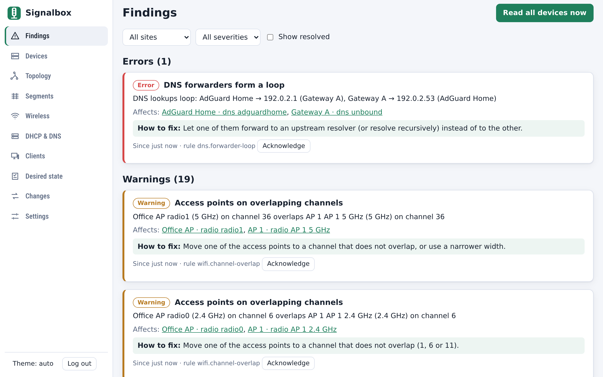
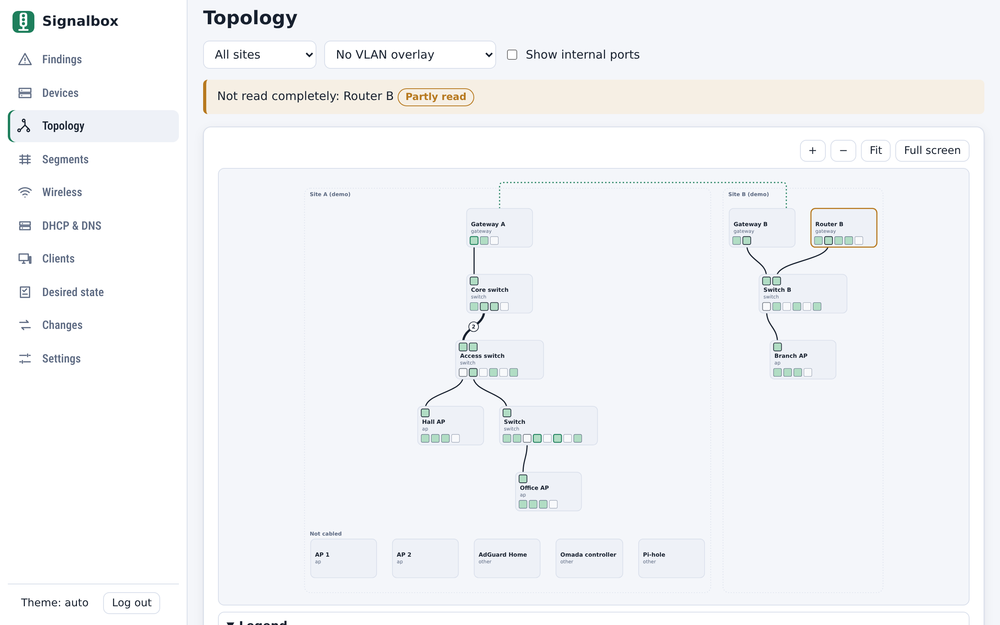
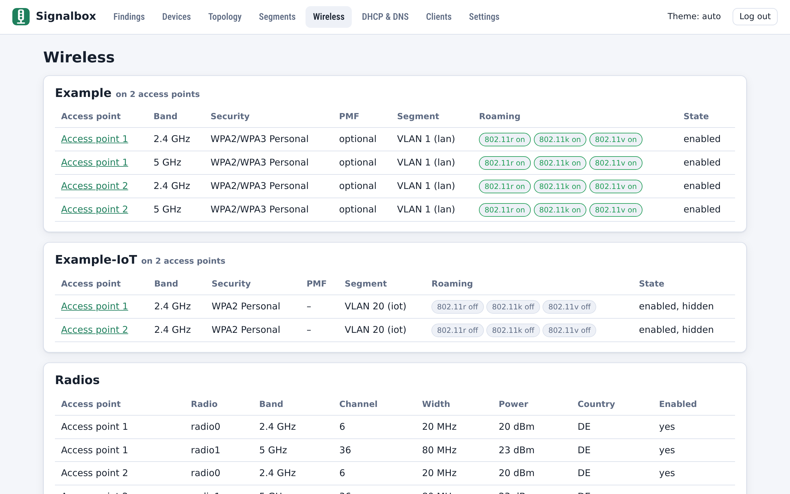
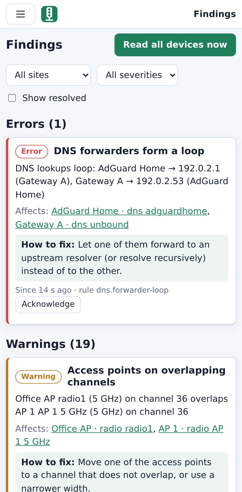

# Signalbox

One place to see and check every device in a small office or home network: router, firewall,
switches, access points. Signalbox reads each device through an adapter into one common model,
shows how everything is wired (ports, cables, VLANs), and checks that the devices agree with each
other: one DHCP server per network, the same Wi-Fi settings on every access point, every VLAN
carried on every link that needs it. Each finding says what is wrong, where, and how to fix it.

> Signalbox is an independent open-source project, not affiliated with, endorsed or supported by
> any of the vendors whose devices it works with. Product names are used only to say what it
> works with.



**Status:** version 0.1, in development. Signalbox reads devices; it does not change them yet.
The adapters are tested against built-in simulators of the device APIs, not yet against real
devices: see [docs/MATURITY.md](docs/MATURITY.md), and please report what you find in
[#21](https://github.com/PhilippMundhenk/signalbox/issues/21).

## How it works

Signalbox is made of separate parts with narrow jobs (details in [docs/DESIGN.md](docs/DESIGN.md#components)):

- **Network model**: one vendor-neutral description of sites, devices, ports, VLANs, subnets,
  DHCP, DNS, Wi-Fi and clients.
- **Integrations**: one adapter per kind of device translates between the device and the model.
- **Checks**: rules run on the model and report findings with a fix; they never change anything.
- **Topology**: how devices are wired, from LLDP, MAC tables and cables you enter.
- **Changes**: a desired state, a planner that turns it into ordered changes, a transactional
  deployment into the devices with backup, verification and automatic rollback, and a change
  log from which every change can be reverted. Off by default; integrations gain write support
  one by one.

## Which devices

| Device | How Signalbox reads it | What it reads |
| --- | --- | --- |
| OPNsense | REST API with a read-only API key ([docs](docs/adapters/opnsense.md)) | interfaces, VLANs, subnets, DHCP (Kea, ISC), Unbound DNS, ARP/NDP and leases; writes: router interfaces (26.7+), VLANs on ports, Kea DHCP subnets and reservations (simulator-tested) |
| OpenWrt (access points, routers) | ubus JSON-RPC over HTTPS with an rpcd user (read-only, or write access to UCI `network`, `wireless`, `dhcp`) | ports, DSA bridge VLANs, Wi-Fi radios and SSIDs, DHCP, connected clients, LLDP; writes: port VLANs, SSIDs, DHCP pools and reservations, through UCI with a confirm-or-revert timer ([docs](docs/adapters/openwrt.md#writing)) |
| NETGEAR ProSAFE Plus switches | NSDP (UDP) through [Switchyard](https://github.com/PhilippMundhenk/switchyard) ([docs](docs/adapters/plusswitch.md)); read, simulator-tested | model, firmware, ports with link and speed, 802.1Q VLANs (tagged/untagged, PVIDs), port-based VLAN groups, link aggregation; writes: ports (802.1Q membership, PVIDs), simulator-tested |
| AVM Fritz!Box | TR-064 (SOAP over HTTPS) with a dedicated user ([docs](docs/adapters/fritzbox.md)); read, simulator-tested | LAN, subnet, DHCP, Wi-Fi radios, SSIDs and guest network, connected hosts; writes: DHCP on/off and pool, existing SSIDs (name, security, passphrase, hidden, on/off) (simulator-tested) |
| MikroTik (RouterOS 7) | REST API over HTTPS with a read-only user group, a group with `write` to deploy ([docs](docs/adapters/mikrotik.md)); read and write, simulator-tested | ports, bridge VLAN filtering, subnets, DHCP, DNS, Wi-Fi (wifi and wireless packages), clients, LLDP/MNDP neighbours; writes: router interfaces (VLANs, addresses), DHCP, static leases, bridge port VLANs, Wi-Fi SSIDs (wifi package) |
| TP-Link Omada (controller with gateway, switches, EAPs) | Open API with a viewer-role client (administrator role for changes), one site per device ([docs](docs/adapters/omada.md)); read, simulator-tested | LAN networks, subnets, DHCP, switch ports and VLANs, radios and SSIDs, clients; writes: LAN networks (router), DHCP, switch ports and SSIDs through the controller, simulator-tested |
| TP-Link Easy Smart switches | Easy Smart protocol (UDP) through [Switchyard](https://github.com/PhilippMundhenk/switchyard) ([docs](docs/adapters/plusswitch.md)); read, simulator-tested | model, firmware, ports with link and speed, 802.1Q VLANs (tagged/untagged, PVIDs), port-based VLAN groups, link aggregation; writes: ports (802.1Q membership, PVIDs), simulator-tested |

Adapters are plugins: other devices can be added as separate packages, see
[docs/ADAPTERS.md](docs/ADAPTERS.md).

## Getting started

1. Run it on any machine that can reach your devices' web interfaces.
   The container runs as user 10001: first run `mkdir -p data && sudo chown 10001:10001 data`
   (or set `user:` to your own ID, see [docs/DEPLOYMENT.md](docs/DEPLOYMENT.md)).

   ```yaml
   services:
     signalbox:
       image: ghcr.io/philippmundhenk/signalbox:latest
       restart: unless-stopped
       ports:
         - "8080:8080"
       volumes:
         - ./data:/data
       environment:
         SIGNALBOX_AUTH_PASSWORD: "choose-a-password"
   ```

   Or without Docker: `pip install .` (`pip install ".[switches]"` for ProSAFE Plus and Easy
   Smart switches) then `signalbox --data ./data serve`.

2. Open `http://<host>:8080` and sign in. Without `SIGNALBOX_AUTH_PASSWORD` a password is
   generated on the first start and printed once in the log (`docker compose logs signalbox`).
   Lost it? `docker compose run --rm signalbox reset-password`, then restart.
3. Create a read-only user on each device: an API key for OPNsense
   ([docs/adapters/opnsense.md](docs/adapters/opnsense.md)), an rpcd login for OpenWrt
   ([docs/adapters/openwrt.md](docs/adapters/openwrt.md)), a dedicated user for a Fritz!Box
   ([docs/adapters/fritzbox.md](docs/adapters/fritzbox.md)), a read-only user group for MikroTik
   ([docs/adapters/mikrotik.md](docs/adapters/mikrotik.md)). NETGEAR ProSAFE Plus and TP-Link
   Easy Smart switches use their management password; their protocols are not encrypted, and
   Easy Smart switches need host networking
   ([docs/adapters/plusswitch.md](docs/adapters/plusswitch.md)).
4. Add the devices under *Devices*. On the first connection Signalbox shows the fingerprint of
   the device's certificate: compare it with the device and trust it. After that a changed
   certificate is refused until you confirm it again.
5. The start page lists the findings. Cables that the devices do not report themselves can be
   entered on the *Topology* page.

Just looking? `docker run --rm -p 8080:8080 -e SIGNALBOX_AUTH_PASSWORD=demo-password-1
ghcr.io/philippmundhenk/signalbox:latest demo` starts Signalbox with a simulated gateway and two
access points; nothing on your network is touched.

## Screenshots

| Topology | Wi-Fi | Phone |
| --- | --- | --- |
|  |  |  |

More in [docs/screenshots.md](docs/screenshots.md).

## Home Assistant

With `SIGNALBOX_MQTT_ENABLED=true` and `SIGNALBOX_MQTT_HOST=<broker>`, Signalbox publishes the
number of findings per site and the status, firmware and client count of every device, with
MQTT discovery, so they appear in Home Assistant without further setup.

## Documentation

- [docs/screenshots.md](docs/screenshots.md): all screenshots
- [docs/CONFIGURATION.md](docs/CONFIGURATION.md): every setting and its environment variable
- [docs/DEPLOYMENT.md](docs/DEPLOYMENT.md): data folder, reverse proxy, backups, updates
- [docs/DESIRED.md](docs/DESIRED.md): declaring what the network should look like, and drift
- [docs/CHANGES.md](docs/CHANGES.md): planning, deploying and undoing changes
- [docs/RULES.md](docs/RULES.md): what each check looks at and how to fix a finding
- [docs/TROUBLESHOOTING.md](docs/TROUBLESHOOTING.md): devices that cannot be read, certificates
- [docs/MATURITY.md](docs/MATURITY.md): what is tested how, and on which real devices
- [docs/adapters/](docs/adapters/): setting up each kind of device
- [docs/ADAPTERS.md](docs/ADAPTERS.md): writing an adapter for another device
- [docs/PLUGINS.md](docs/PLUGINS.md): adapters as separate programs, rule and exporter plugins
- [docs/API.md](docs/API.md): the HTTP API
- [docs/DESIGN.md](docs/DESIGN.md): design and plans; [docs/adr/](docs/adr/): decisions
- [CONTRIBUTING.md](CONTRIBUTING.md), [SECURITY.md](SECURITY.md), [CHANGELOG.md](CHANGELOG.md)

Work is tracked in the [issues](https://github.com/PhilippMundhenk/signalbox/issues).

## License

MIT, see [LICENSE](LICENSE).
