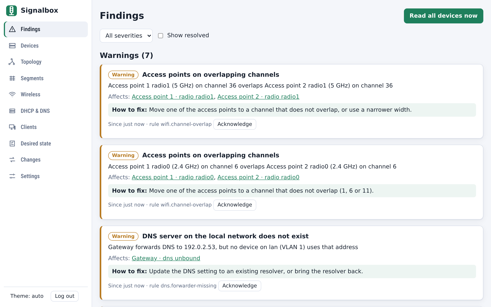
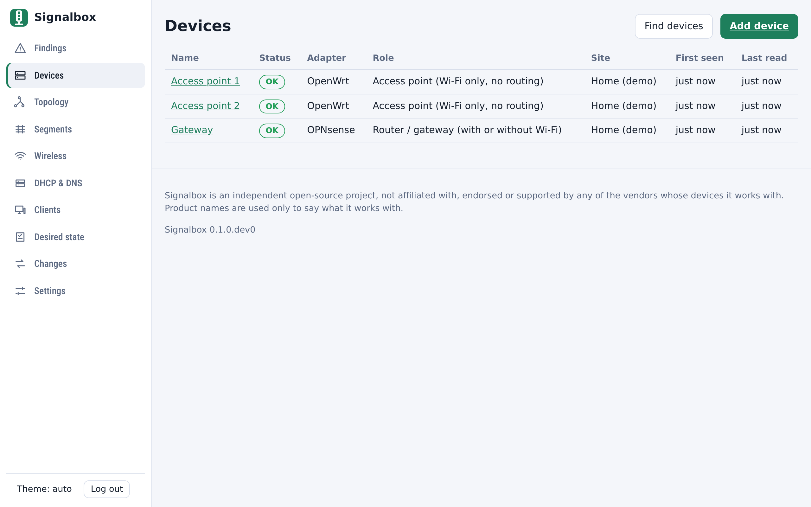
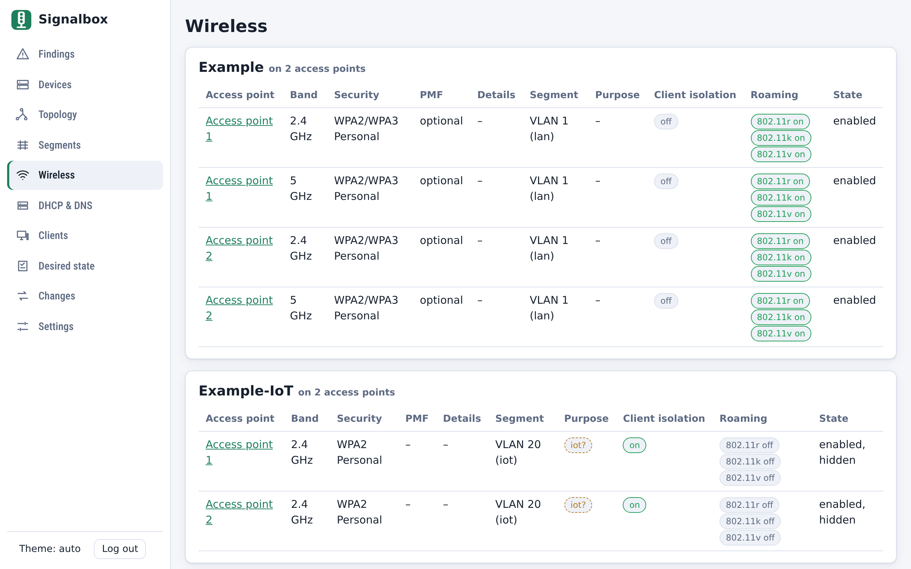
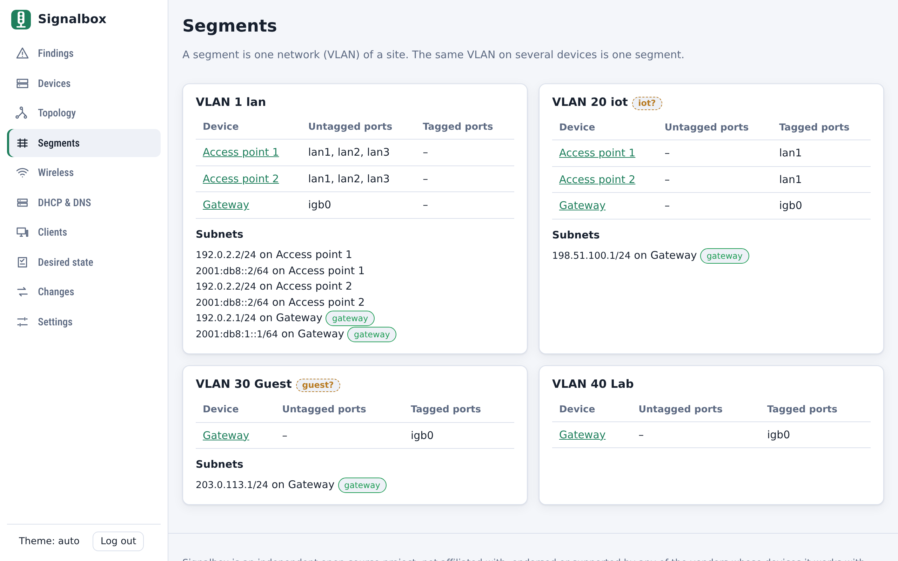
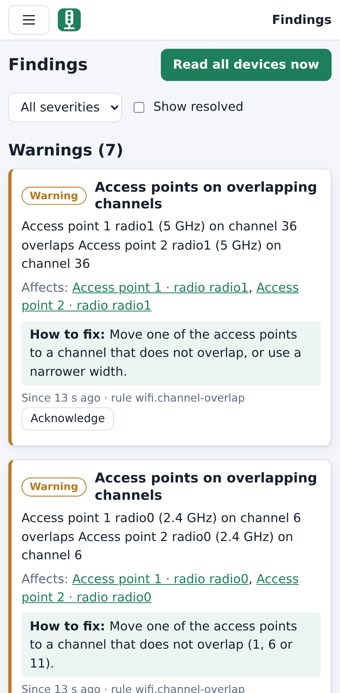
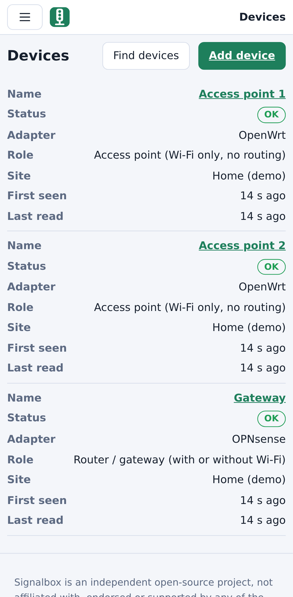
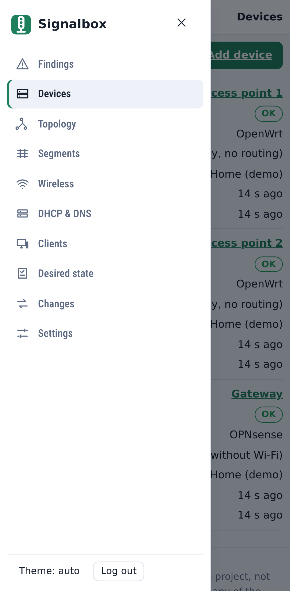

# Screenshots

Taken from `signalbox demo` (a simulated OPNsense gateway and two OpenWrt access points) by
`python tools/screenshots.py` (`make screenshots`). No real network is shown.

| | |
| --- | --- |
|  Findings, the start page |  The same in dark mode |
|  Devices with their status |  Topology: cables, ports, VLANs per link |
|  Wi-Fi: SSIDs across access points |  Segments (VLANs) and their ports |
|  Findings on a phone |  Devices on a phone |
|  The menu drawer on a phone | |
