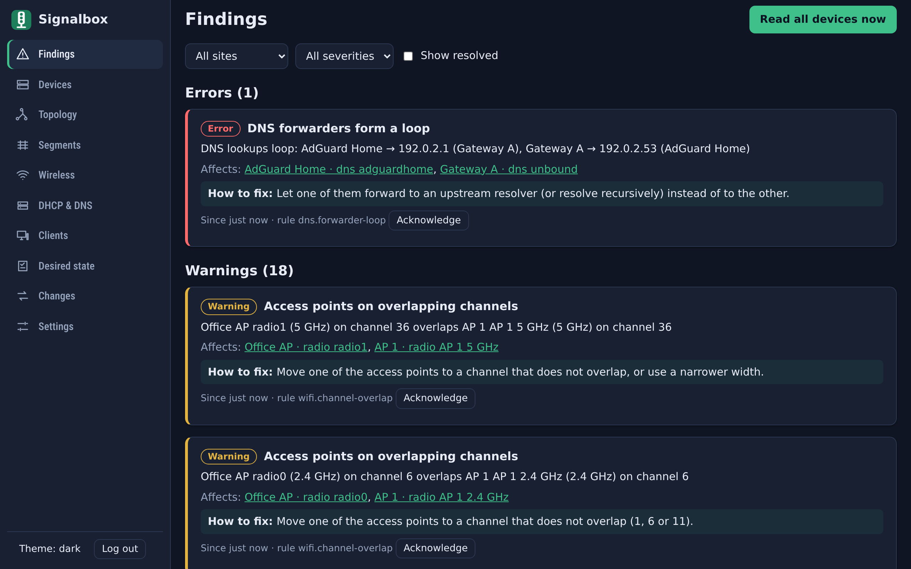
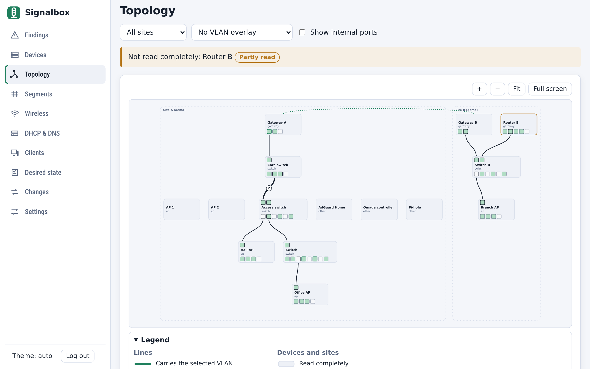
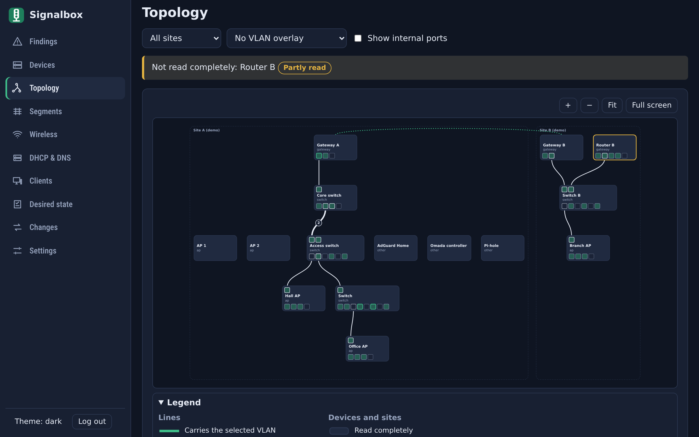
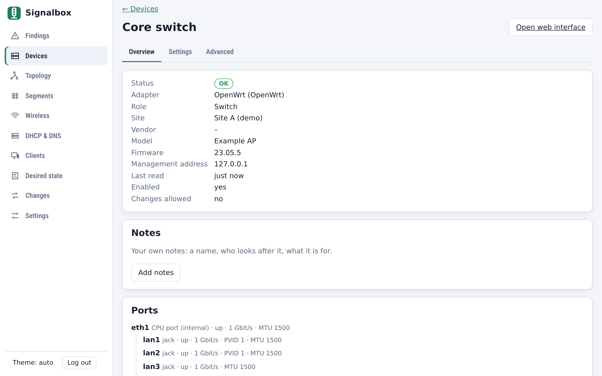
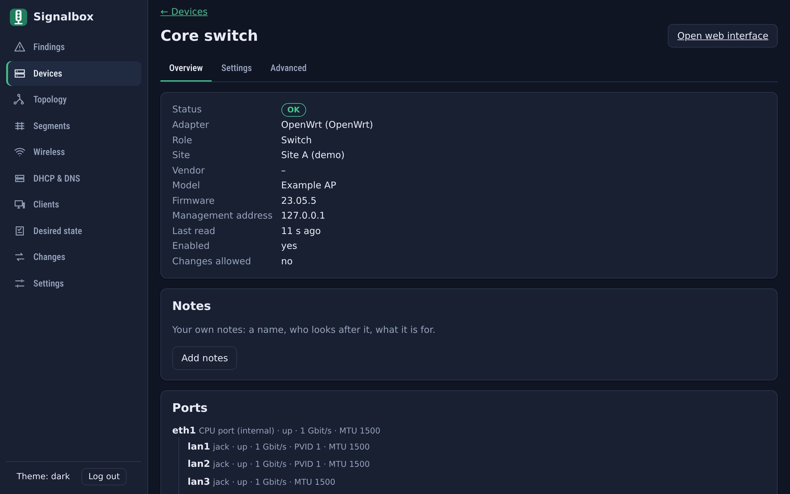
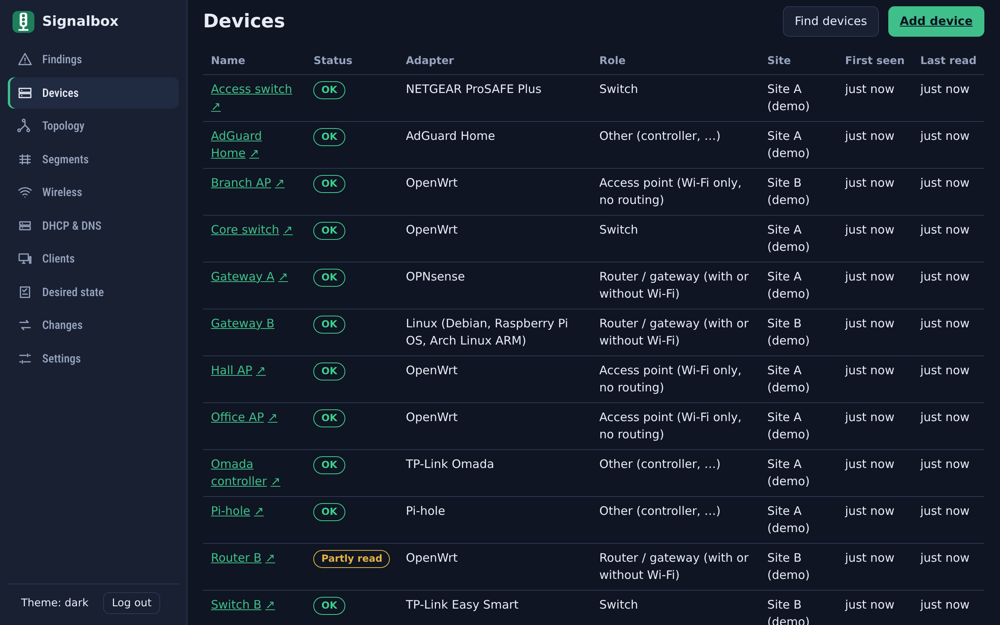

# Screenshots

Taken from `signalbox demo` (twelve simulated devices over two sites, about 17 with the Omada controller's: OPNsense and Linux gateways with a WireGuard link, OpenWrt, Omada, NETGEAR and TP-Link switches, AdGuard Home, Pi-hole) by
`python tools/screenshots.py` (`make screenshots`). No real network is shown.

| | |
| --- | --- |
|  Findings, the start page |  The same in dark mode |
|  Devices with their status |  Topology: cables, ports, VLANs per link |
|  Wi-Fi: SSIDs across access points |  Segments (VLANs) and their ports |
|  Findings on a phone |  Devices on a phone |
|  The menu drawer on a phone |  Topology in dark mode, with the legend |
|  A device page (OpenWrt switch) |  The same in dark mode |
|  Devices in dark mode | |
